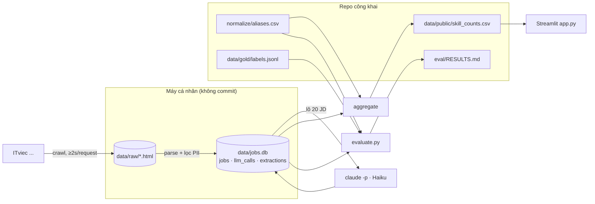

# Kiến trúc — JobMarket VN

Chương trình Python chạy batch trên máy cá nhân. Không có server, không có hàng đợi.
Các bước nối với nhau qua một file SQLite và vài file phẳng. Thứ tự chạy và lệnh của từng bước: `docs/pipeline.md`.

## Sơ đồ

Bản tương tác (archify, mở bằng trình duyệt): `.archify/dataflow-pipeline-20261117-150256/pipeline.html`; nguồn JSON nằm cùng thư mục. Sửa `candidate.json` rồi chạy lại `archify finalize` khi kiến trúc đổi.

## Thành phần

| Module | Việc làm | Phụ thuộc ngoài |
|---|---|---|
| `crawl/jobposting.py` | phần chung mọi nguồn có JSON-LD `JobPosting`: fetch (robots, delay, retry), sitemap, parse, vòng crawl lưu HTML gốc | stdlib |
| `crawl/itviec.py` | cấu hình ITviec: URL robots/sitemap, lọc AI/Data theo nội dung (`is_ai_data`), tên file HTML gốc | stdlib |
| `extract/pii.py` | che email, SĐT | stdlib |
| `extract/llm.py` | gom lô, gọi `claude -p`, kiểm schema, ghi cache/log | Claude Code CLI, `pydantic` |
| `normalize/` | ánh xạ kỹ năng thô → tên chuẩn bằng `aliases.csv` | stdlib |
| `aggregate.py` | đếm kỹ năng theo nguồn/tháng → CSV công khai | stdlib |
| `db.py` | tạo bảng, đọc/ghi | `sqlite3` |
| `gold.py` | chọn 40 JD gold, đọc nhãn | stdlib |
| `evaluate.py` | P/R/F1 micro trên gold set, ghi `eval/RESULTS.md` | stdlib |
| `app.py` | dashboard | Streamlit |
| v2: `route/`, `train/` · v3: `mcp/` | thiết kế khi tới giai đoạn | |

Mỗi module chỉ đọc/ghi DB qua `db.py`. Logic thuần (parse, che PII, chuẩn hoá, chấm điểm) tách khỏi I/O để test offline trên `tests/fixtures/`.

## Lưu trữ: `data/jobs.db`

**`jobs`** (đã có) — một dòng mỗi URL JD.
`url` PK · `source` · `title` · `company` · `date_posted` · `valid_through` · `tags` (JSON, thẻ của nguồn) · `description` (đã lọc PII) · `fetched_at`

**`llm_calls`** (bước 3) — một dòng mỗi lần gọi `claude -p`.
`call_id` PK · `model` · `prompt_version` · `n_jd` · `cost_usd` (quy đổi) · `input_tokens` · `output_tokens` · `latency_ms` · `error` (NULL nếu ổn) · `created_at`

**`extractions`** (bước 3) — một dòng mỗi JD × model × phiên bản prompt.
`content_hash` · `model` · `prompt_version` — PK chung, đồng thời là khoá cache · `url` · `skills` (JSON, kỹ năng thô) · `call_id` → `llm_calls`

Chi phí trên 1.000 JD = `sum(cost_usd) / sum(n_jd) × 1000`, lấy từ `llm_calls` không lỗi.
`content_hash` = sha256 của `description` sau khi gộp khoảng trắng.

## Quyết định thiết kế

| Quyết định | Lý do |
|---|---|
| Lưu HTML gốc trước khi parse | Sửa parser chỉ cần parse lại, không phải crawl lại (đã dùng 1 lần khi sửa lỗi khoảng trắng ở tên công ty). |
| Sitemap thay vì trang danh sách | Không phải xử lý phân trang; trang danh sách đổi giao diện thì crawler không hỏng. |
| SQLite một file, stdlib | 1.000 JD chỉ vài MB; v3 MCP server đọc thẳng file này ở chế độ chỉ đọc. |
| LLM qua `claude -p` | Không dùng API key. Xem ADR 0001. |
| Lô 20 JD mỗi lần gọi | Giảm số lần gọi (hạn mức gói tính theo lượt), chi phí prompt hệ thống chia cho 20. |
| Lưu kỹ năng thô, chuẩn hoá lúc đọc | Sửa bảng alias rồi chấm lại eval ngay, không tốn lượt LLM. |
| Cache theo hash nội dung, không theo URL | JD đăng lại với URL mới vẫn trúng cache; JD sửa nội dung thì trích lại. |
| Chỉ CSV tổng hợp được công khai | Điều khoản ITviec §2.2: không đăng lại nội dung JD. Xem `docs/research/itviec.md`. |

## Ranh giới dữ liệu

| Dữ liệu | Ở đâu | Commit? |
|---|---|---|
| HTML gốc, `jobs.db` | `data/raw/`, `data/jobs.db` | Không (`.gitignore`) |
| Nhãn gold (url + kỹ năng) | `data/gold/labels.jsonl` | Có |
| Số liệu tổng hợp | `data/public/` | Có, đây là đầu vào của dashboard công khai |
| Fixture test | `tests/fixtures/` | Có, chỉ giữ JSON-LD, nội dung JD thay bằng văn bản mẫu |

## Ngoài phạm vi v1
Crawl định kỳ, nhiều người dùng, API công khai, upload CV. Đề xuất các mục này thì hỏi người dùng trước (CLAUDE.md).
